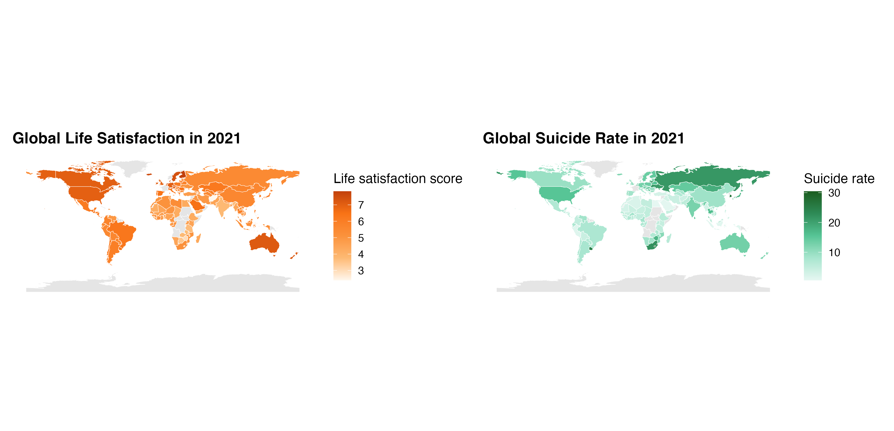

# Mental Health Around the World — Data Exploration & Visualisation (R)

Individual coursework from Monash FIT5147 (Semester 1, 2026), built around one
self-chosen question: **do environmental and geographic factors — especially
sunlight — relate to mental-health indicators across countries?**

I took it end to end: sourcing and merging open data, exploratory analysis in R
(project 01), then turning the findings into an interactive scrollytelling web app
in R Shiny for a general audience (project 02).

## 01 — Data exploration project
`01-data-exploration-project/`

**Questions**
1. How do mental-health outcomes vary across global regions?
2. How does annual sunlight exposure relate to mental-health indicators?
3. Do life satisfaction and suicide rate show similar or contrasting patterns?

**What I did** — merged three open sources (Our World in Data life-satisfaction
and suicide-rate data; NASA POWER solar radiation, pulled per country through the
`nasapower` API using country centroid coordinates); harmonised country codes,
handled regional aggregates with missing codes, fixed coordinate gaps, and checked
coverage and duplicates; then explored with maps (`sf`, `rnaturalearth`),
distributions, trends, continent-level comparisons and country scatter plots.

**Findings** — both indicators vary clearly by region but don't follow the same
geographic pattern; more sunlight did *not* line up with higher wellbeing (if
anything the global relationship is slightly negative); and life satisfaction and
suicide rate are related but not interchangeable — population mental health is
better read through more than one indicator.

`analysis.R` (full pipeline) · `report.pdf` · `figures/` · `data/`

## 02 — Interactive narrative visualisation (R Shiny)
`02-interactive-narrative-visualisation/`

A linear, scrollytelling Shiny app that walks a non-technical reader through the
three findings above, one plain-language question per section, with interactive
Leaflet maps and Plotly charts and a short highlighted takeaway for each.
Designed with the **Five Design Sheet** method — my hand-drawn sheets are in
`design-sheets/`.

Run it: open `app/app.R` in RStudio → **Run App** (needs `shiny`, `tidyverse`,
`countrycode`, `leaflet`, `plotly`, `shinyjs`).

`app/` · `report.pdf` (design rationale) · `presentation.pdf` · `design-sheets/`

## 03 — Visualisation exercises
`03-visualisation-exercises/` — three shorter exercises on Atlas of Living
Australia bird-observation data, one per tool:

- **PE1 — Tableau:** data checking/cleaning (e.g. spotting a geographic outlier
  on a map) and a dashboard — `pe1_dashboard.twb`
- **PE2 — R Shiny + Leaflet:** seasonal observation patterns with an interactive
  map (checkbox filters, hover tooltips) — `app.R`
- **PE3 — D3.js:** an interactive taxonomic tree (d3 cluster layout) with
  per-node glyphs, from a provided starter scaffold — `pe3_tree.html`

Each has a short report on the design choices. The ALA datasets were provided by
the unit and aren't included.

## Tech stack

R — tidyverse, sf, rnaturalearth, countrycode, nasapower, patchwork, ggrepel,
Shiny, Leaflet, Plotly, shinyjs · Tableau · D3.js

## Data & licences

`happiness-cantril-ladder.csv` and `death-rate-from-suicides-ghe.csv` are from
[Our World in Data](https://ourworldindata.org) (CC BY 4.0). Solar radiation data
is from [NASA POWER](https://power.larc.nasa.gov/).
